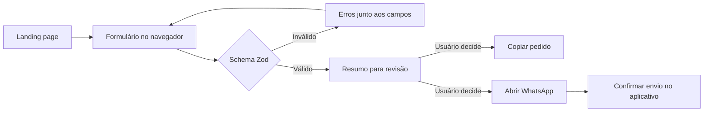

# Arquitetura e decisões

## Objetivo

Apresentar um consultor de planos de saúde e transformar interesse em uma conversa pelo WhatsApp. O formulário é um direcionador: organiza o pedido, sem consultar preços, decidir elegibilidade ou contratar planos.

## Fluxo

## Limites dos módulos

- `App.tsx` compõe as seções e coordena a seleção de perfil pelos cards.
- `sections/` contém a apresentação, sem consultar serviços externos.
- `components/` contém marca, navegação, rodapé e privacidade.
- `features/quote/quote.ts` concentra schema, tipos e funções de mensagem. A validação independe de React e é exercitada em testes unitários.
- `features/quote/QuoteForm.tsx` controla interação e campos dinâmicos, delegando as regras ao schema.
- `features/quote/location.ts` isola a consulta opcional de coordenadas atuais no BigDataCloud e valida país, cidade e UF antes de preencher. Permissão negada, serviço indisponível ou resposta inválida mantêm a entrada manual.
- `config/site.ts` reúne apenas informações públicas do atendimento.
- `styles/global.css` contém tokens e elementos compartilhados; CSS Modules evita colisões entre componentes. `App.module.css` compartilha o layout entre as seções.

## Decisões e consequências

| Decisão                               | Motivo                                                          | Consequência aceita                                                  |
| ------------------------------------- | --------------------------------------------------------------- | -------------------------------------------------------------------- |
| Aplicação estática                    | O fluxo atual termina em uma conversa externa                   | Não há painel de leads ou cotador                                    |
| React e TypeScript                    | Componentes e contratos explícitos para evoluir a experiência   | Mais JavaScript do que uma página HTML equivalente                   |
| React Hook Form e Zod                 | Validar listas de pessoas e regras condicionais                 | Duas dependências com papéis distintos, não dois conjuntos de regras |
| Schema antes de construir a mensagem  | Impedir que dados inválidos escapem pela função de domínio      | A função lança erro se chamada fora do fluxo com dados inválidos     |
| Resumo associado aos campos atuais    | Evitar compartilhar um pedido desatualizado                     | Após editar, é necessário preparar novamente                         |
| Sem persistência dos campos           | Evitar uma base de dados desnecessária para a primeira conversa | Recarregar a página perde o preenchimento                            |
| Links externos acionados pelo usuário | Deixar a transferência de dados explícita                       | Clique não comprova envio nem recebimento de mensagem                |
| Tipografia de sistema e arte vetorial | Evitar requisições a bancos de fontes e fotos genéricas         | Aparência depende parcialmente das fontes do sistema                 |

## Evidências de qualidade

`npm run check` reúne lint, testes, tipos, build e formatação. O workflow de CI executa o mesmo comando. A configuração do workflow existe; o histórico remoto de execução só existirá depois do envio ao GitHub.

Os testes cobrem regras de idade, perfil empresarial, codificação do destinatário e da mensagem, edição do resumo, remoção de pessoas, falha de cópia, preservação de dados ao trocar perfil e fechamento do menu por teclado.

Testes em jsdom não medem layout, contraste real, foco nativo do diálogo em todos os navegadores ou entrega no WhatsApp. Essas verificações continuam na revisão de navegador. Não há pontuação de Lighthouse ou métricas de conversão declaradas sem medição.

## Evolução prevista

O atendimento agora é nacional. A localização é apenas uma sugestão editável, não uma confirmação da disponibilidade de um produto. O formulário não assume uma cidade padrão e preserva o que foi editado enquanto uma consulta está pendente.

Depois da revisão do projeto, publicação estática e configuração do domínio. A medição de acessos e o envio diário por e-mail ficam em uma etapa separada, documentada em [REPORTING.md](REPORTING.md). Um serviço de cotação não faz parte do escopo atual nem é requisito para o relatório de acessos.
